# pizzou 🍕

**Menos conta. Mais pizza.** Uma calculadora para descobrir quantas pizzas pedir, ajustar a fome da galera e decidir os sabores por votação.

[Usar o pizzou](https://pizza.lilbigcheetos.com/) · [Como usar](#como-usar) · [Rodar localmente](#rodar-localmente) · [Como a conta funciona](#como-a-conta-funciona) · [Desenvolvimento](#desenvolvimento)

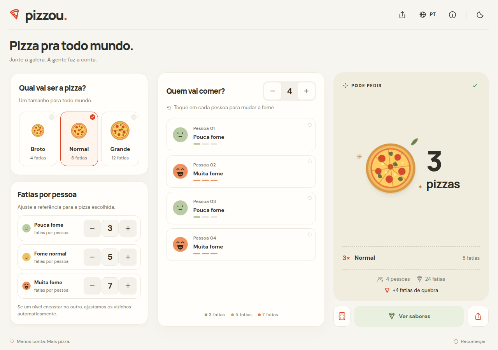

## O que dá para fazer

- Escolher um tamanho por pedido: broto, normal ou grande.
- Definir quantas fatias significam **pouca fome**, **fome normal** e **muita fome** para o seu grupo.
- Configurar de 1 a 50 pessoas, com fome individual.
- Calcular pizzas inteiras suficientes para a fome estimada, mostrando as sobras.
- Votar em até 12 sabores e dividir pizzas em **inteiras, metades, terços ou quartos**.
- Ver as pizzas do mesmo sabor próximas umas das outras, inclusive quando parte do sabor está em uma pizza mista.
- Exportar uma notinha PNG com as quantidades, referências de fome e sabores escolhidos.
- Alternar entre português brasileiro, inglês, francês, espanhol e chinês simplificado, além dos temas claro e escuro.

O app funciona no navegador, sem cadastro e sem backend de dados. A votação acontece no mesmo aparelho, que passa de pessoa para pessoa.

## Como usar

### 1. Escolha a pizza

Selecione o tamanho que a pizzaria oferece. Todos receberão pizzas desse tamanho no mesmo pedido.

| Tamanho | Fatias por pizza |
| --- | ---: |
| Broto | 4 |
| Normal | 8 |
| Grande | 12 |

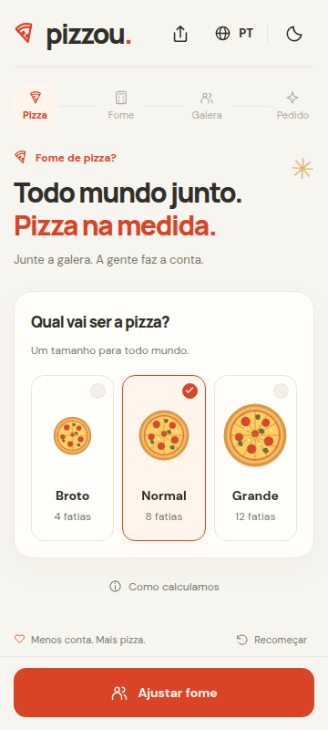

Toque em **Ajustar fome** para continuar.

### 2. Defina a referência de fome

Antes de escolher as pessoas, diga o que cada nível de fome significa para esse pedido. Os valores iniciais são **3, 5 e 7 fatias por pessoa**.

Cada seletor tem uma carinha e um nome, o botão **−** à esquerda, o número no centro e o botão **+** à direita. Os três seletores ficam empilhados no modo vertical.

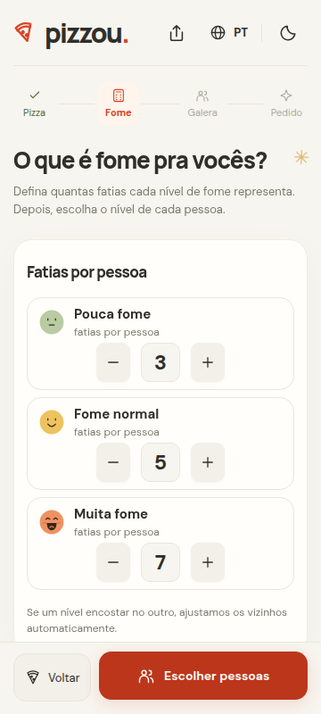

A ordem é sempre estrita:

```text
1 ≤ pouca fome < fome normal < muita fome
```

Os níveis se ajustam **em cascata**, com uma animação nos valores afetados:

- Ao aumentar um nível até alcançar o seguinte, o seguinte sobe junto. De **3 / 4 / 5**, aumentar pouca fome para 4 resulta em **4 / 5 / 6**.
- Ao diminuir um nível até alcançar o anterior, o anterior desce junto. De **3 / 5 / 7**, baixar muita fome até 3 resulta em **1 / 2 / 3**.
- A cascata só move os vizinhos necessários. De **3 / 5 / 7**, baixar fome normal para 4 mantém **3 / 4 / 7**.
- O mínimo é **1 / 2 / 3**. Nesse ponto os três botões de diminuir ficam desabilitados; aumentar continua disponível.

Não há teto de produto em 99: é possível continuar aumentando as referências. A implementação usa os inteiros seguros do JavaScript.

Os números representam **fatias por pessoa**, e a referência é a pizza do tamanho escolhido. Se você mudar o tamanho, pode reajustar essa referência. Os valores ficam salvos neste navegador e **Recomeçar** restaura 3 / 5 / 7.

Toque em **Escolher pessoas**.

### 3. Monte a galera

Use **− / +** ou digite a quantidade de pessoas. Toque no cartão de cada pessoa para alternar entre pouca fome, fome normal e muita fome. A legenda abaixo mostra os valores configurados no passo anterior.

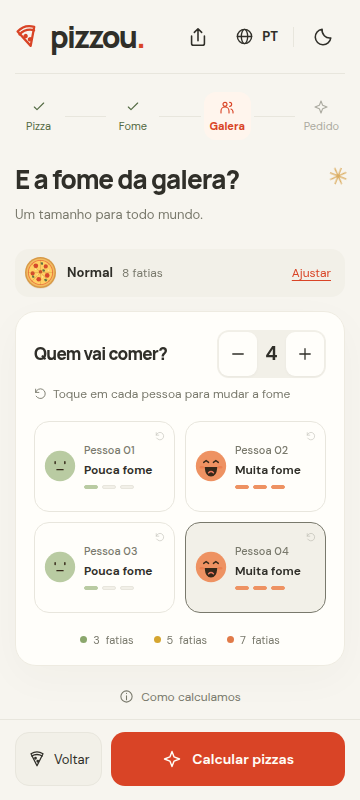

Toque em **Calcular pizzas**. Para revisar a referência, use **Voltar** ou o passo **Fome** no topo.

### 4. Confira a quantidade

O pedido mostra o total de pizzas, tamanho escolhido, total de fatias e eventuais sobras. Você pode compartilhar esse resultado diretamente ou seguir para **Decidir sabores**.

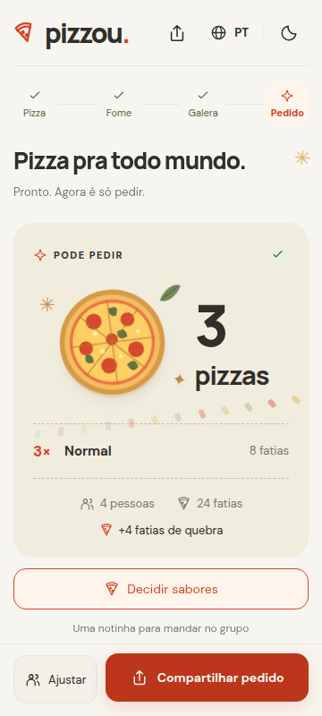

### 5. Cadastre os sabores e a divisão

Digite os sabores disponíveis na pizzaria e toque em **+**, ou abra **Sugestões**. São necessários de 2 a 12 sabores, com até 40 caracteres cada. Nomes repetidos não são aceitos.

Escolha a menor porção que a pizzaria permite:

| Divisão | Porções por pizza | Frações possíveis |
| --- | ---: | --- |
| Inteiras | 1 | Uma pizza inteira |
| Metades | 2 | 1/2 ou inteira |
| Terços | 3 | 1/3, 2/3 ou inteira |
| Quartos | 4 | 1/4, 1/2, 3/4 ou inteira |

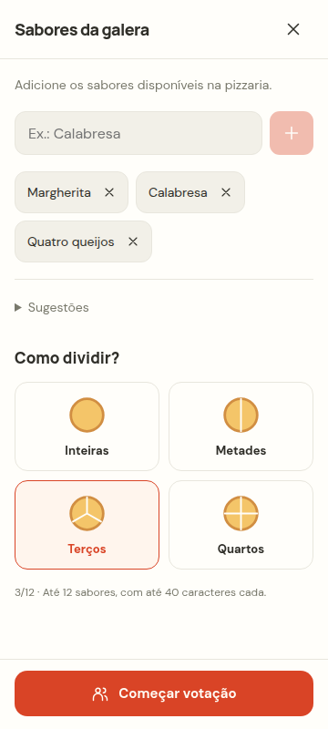

A divisão dos **sabores** é independente da quantidade de **fatias** usada no cálculo de fome. Uma pizza normal de 8 fatias pode ser alocada em três sabores se a pizzaria aceitar essa divisão; o app não tenta representar cada fatia como um voto.

Toque em **Começar votação**.

### 6. Confira quem vai votar e ordene as preferências

Antes do **primeiro voto** e entre todas as pessoas, a tela mostra uma carinha grande, o número da pessoa, o nível de fome e o peso daquele voto. Confira se é sua vez e toque em **Sou eu**.

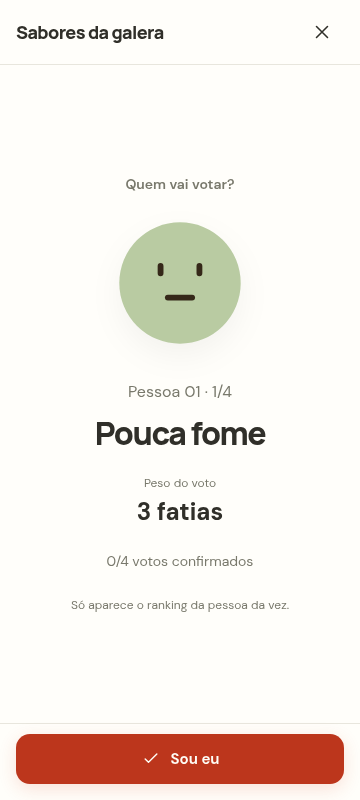

Coloque o sabor favorito no topo. Arraste pela alça ou toque nos botões de subir e descer. Todos os sabores devem estar ordenados; a ordem inicial é embaralhada para cada pessoa.

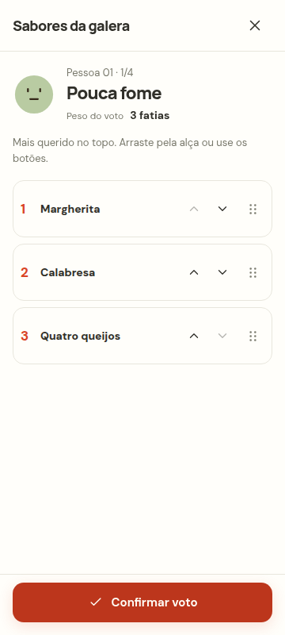

Toque em **Confirmar voto**. A tela de passagem esconde o ranking anterior antes de liberar a próxima pessoa.

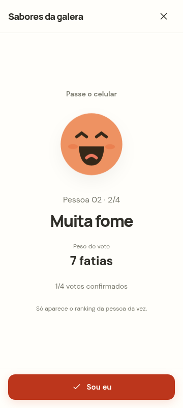

A próxima pessoa confere sua fome, toca em **Sou eu** e faz seu ranking. A identidade e o peso continuam visíveis durante o voto.

O **peso do voto corresponde às fatias configuradas para a fome daquela pessoa**. Com as referências 3 / 5 / 7, os pesos são 3, 5 e 7. Pessoas com a mesma fome têm o mesmo peso; quem pretende comer mais participa proporcionalmente mais da escolha. O app usa as referências personalizadas do pedido, sem multiplicadores extras por categoria.

### 7. Veja os sabores agrupados

O resultado conserva a quantidade calculada de pizzas, monta inteiras quando possível e reúne as frações restantes em pizzas mistas. As pizzas com sabores em comum ficam próximas: por exemplo, uma pizza inteira de Margherita aparece junto da pizza com a fração restante de Margherita.

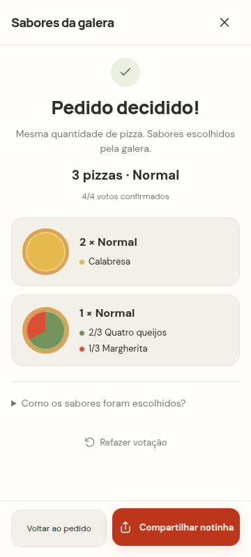

A mesma ordem é usada na notinha. Na captura acima, as duas pessoas com muita fome preferiram Calabresa e receberam duas pizzas desse sabor; as preferências das pessoas com pouca fome aparecem na pizza mista. **Como os sabores foram escolhidos?** mostra as rodadas e a ordem de desempate. **Refazer votação** mantém os sabores e a divisão, mas limpa os votos.

### 8. Compartilhe a notinha

Toque em **Compartilhar notinha** ou **Compartilhar pedido** para abrir a prévia. Use **Salvar imagem** para baixar o PNG ou **Compartilhar** para abrir as opções nativas do aparelho.

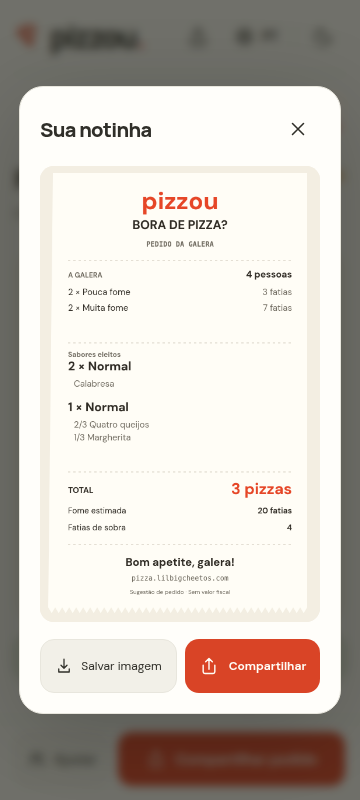

<details>
<summary>Ver o PNG exportado completo</summary>

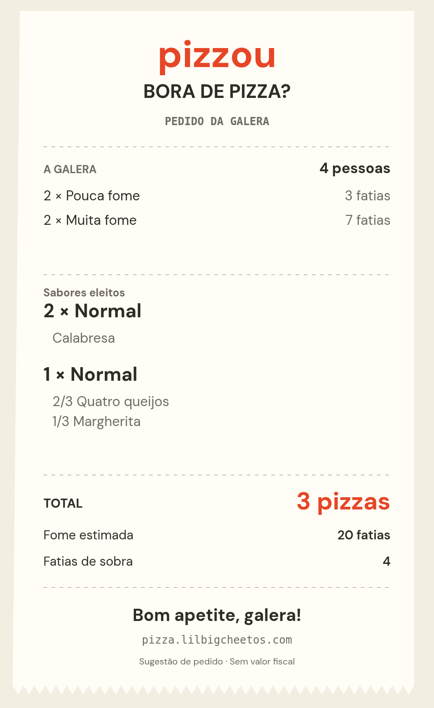

</details>

Quando o navegador não permite compartilhar arquivos, o app baixa o PNG para você anexar no aplicativo desejado. O pizzou não envia pedidos automaticamente à pizzaria.

O botão de compartilhar no **cabeçalho** compartilha o link do app. Ele usa o menu nativo quando disponível; caso contrário, oferece WhatsApp, Telegram e cópia do link.

## Telas verticais e horizontais

No celular e tablet em pé, o fluxo tem quatro passos: **Pizza → Fome → Galera → Pedido**. Você pode voltar aos passos anteriores sem perder as escolhas. O cálculo ocorre ao tocar no botão.

Em desktop ou telas horizontais compatíveis, o mesmo estado aparece em três colunas:

1. **Esquerda:** tamanho da pizza e referências de fome.
2. **Centro:** quantidade de pessoas e fome individual.
3. **Direita:** resultado, sabores e compartilhamento.

A tela em colunas é ativada a partir de 1024px de largura ou em orientação horizontal a partir de 560px. As colunas de pizza e pessoas têm rolagem própria quando o conteúdo não cabe, mantendo as ações do pedido acessíveis. Girar o aparelho preserva as escolhas e a votação em andamento.

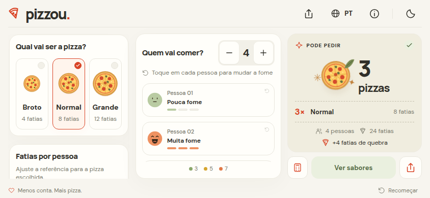

Depois do primeiro cálculo no modo de colunas, qualquer mudança no pedido oculta o resultado antigo e recalcula após 280ms sem novas alterações. Compartilhar e votar ficam indisponíveis durante a atualização. Alterar a referência de fome também invalida a votação anterior.

<details>
<summary>Ver tablet vertical e temas escuros</summary>

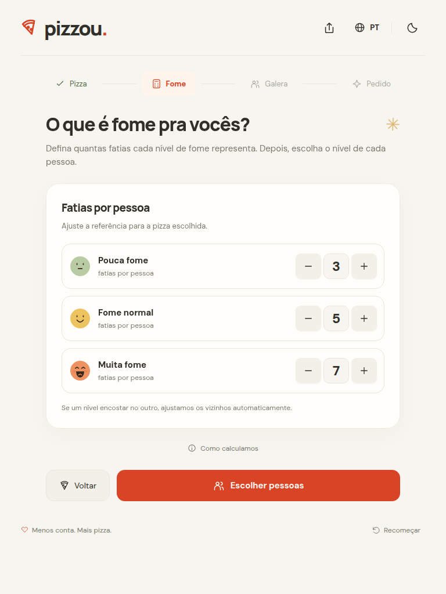

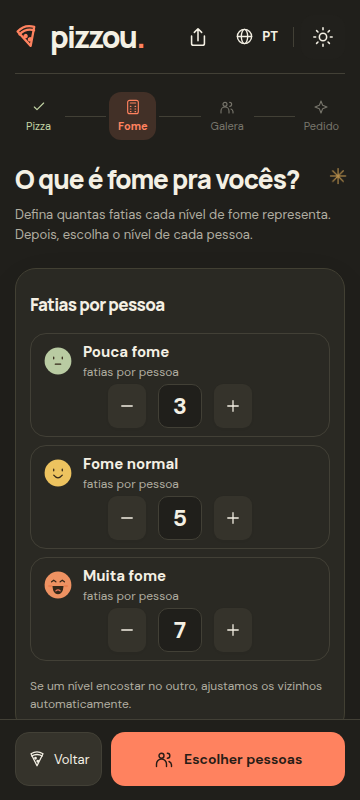

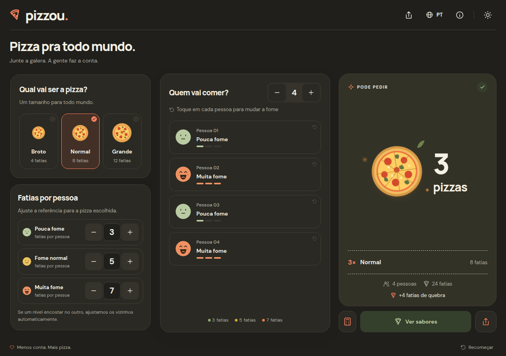

</details>

## Como a conta funciona

O app soma as fatias correspondentes à fome de cada pessoa e arredonda para cima:

```text
fome estimada = soma das referências de fome de todas as pessoas
pizzas = teto(fome estimada / fatias por pizza)
sobras = pizzas × fatias por pizza − fome estimada
```

Exemplo: com referências **3 / 5 / 7**, quatro pessoas com fome normal precisam de **20 fatias**. Escolhendo pizza normal de 8 fatias, o resultado é **3 pizzas**, com **24 fatias** e **4 de sobra**. Se a referência de fome normal mudar, a conta passa a usar o novo valor.

O cálculo retorna o menor número de pizzas inteiras do tamanho escolhido que cobre essa estimativa. A conta usa equivalência por fatias; não considera diâmetro, área, peso ou diferenças entre pizzarias.

### Apuração de sabores

O sistema usa votação por preferências com uma adaptação proporcional para sabores repetíveis:

- **Peso inicial:** cada ranking recebe o peso das fatias estimadas daquela pessoa. A soma dos pesos corresponde à fome estimada do grupo.
- **Uma única porção:** votação eliminatória (IRV). A maioria é calculada sobre o peso total. Se ninguém atingir mais da metade desse peso, elimina-se o sabor menos apoiado e transfere-se o peso à próxima preferência disponível.
- **Várias porções:** a cota por porção é `soma dos pesos / total de porções`. Cada porção eleita consome essa quantidade de apoio; o peso restante dos votos continua disponível. Um sabor pode receber várias porções.
- **Eliminação:** se ninguém atingir a cota, elimina-se o sabor com menor apoio restante. As porções já atribuídas a ele continuam no pedido.
- **Empates:** compara-se o apoio nas rodadas anteriores; persistindo o empate, usa-se uma ordem sorteada e fixada no início da sessão.
- **Montagem:** separa pizzas inteiras e combina os restos sem criar ou perder porções. Depois, aproxima grupos que compartilham sabores. A ordenação não muda a apuração.

Exemplo de proporcionalidade: duas pessoas apoiam A com pesos 3 e 5, e uma apoia B com peso 7. Em 15 porções, a cota é 1 e a distribuição fica **8 porções de A e 7 de B**. Cada porção consome apoio; o mesmo peso não é reutilizado integralmente nas rodadas seguintes. Multiplicar todos os pesos pela mesma constante não muda essa distribuição.

A inspiração é o voto preferencial australiano. A ponderação pela fome, a cota por porção e a possibilidade de repetir um sabor são adaptações do pizzou; o sistema não reproduz integralmente as regras eleitorais do Senado australiano.

Referências: [AEC — voto preferencial](https://www.aec.gov.au/learn/preferential-voting.htm) e [AEC — contagem do Senado](https://www.aec.gov.au/Voting/counting/senate_count.htm).

## Dados e privacidade

- Tamanho, referências de fome, pessoas, idioma e tema ficam no `localStorage` do navegador, na chave `pizzou-v2`.
- Preferências antigas são migradas. Dados inválidos de fome voltam a 3 / 5 / 7.
- Rankings e votos ficam somente na memória da aba. Recarregar a página perde a votação.
- Fechar e reabrir o diálogo de sabores preserva a sessão enquanto o pedido não mudar.
- Alterar tamanho, quantidade de pessoas, fome individual ou suas referências limpa o resultado de sabores.
- A notinha é gerada localmente com Canvas; os dados não são enviados a um servidor.
- O app não exige conta nem chaves de API. As fontes latinas são servidas localmente.

## Rodar localmente

Requer **Node.js 20.19+ ou 22.12+** e npm.

```bash
git clone https://github.com/Caio-Saraiva/pizzou.git
cd pizzou
npm ci
npm run dev
```

Abra **http://localhost:3000**. Para usar outra porta durante o desenvolvimento:

```bash
npm run dev -- --port 3001
```

### Build e servidor de produção

```bash
npm run build
npm start
```

O servidor Node serve `dist/` em `0.0.0.0:3000`. Para alterar a porta:

```bash
PORT=8080 npm start
```

Não execute desenvolvimento e produção na mesma porta ao mesmo tempo. Para atualizar um servidor em execução, gere um novo build. Alterações em `server.mjs` exigem reiniciar o processo.

### Hospedagem estática e Cloudflare Tunnel

O build de `dist/` pode ser servido em uma hospedagem estática. O projeto não depende de um serviço de dados.

Para expor o servidor local pelo Cloudflare Tunnel, configure o hostname desejado com serviço **HTTP** e destino **localhost:3000**, se `cloudflared` estiver no mesmo host. Se estiver em container, use o endereço do host acessível por ele. O HTTPS é terminado pelo Cloudflare.

A URL do app usada no compartilhamento está em `src/share.js`, e os metadados públicos estão em `index.html`. Ao hospedar em outro domínio, atualize também a URL impressa na notinha em `src/receipt.js` e os textos da arte social em `scripts/social-card.mjs`.

Para um serviço systemd de usuário já configurado como `pizzou.service`, os comandos de operação são:

```bash
systemctl --user status pizzou
systemctl --user restart pizzou
journalctl --user -u pizzou -n 50
```

A unidade de serviço é uma configuração do host e não é necessária para rodar o projeto.

## Desenvolvimento

JavaScript com módulos ES, CSS e Vite. Sem framework de interface e sem dependências de execução no navegador.

```text
src/
  main.js             Estado, fluxo de quatro passos e eventos
  appetite-editor.js  Componente reutilizável de referências de fome e limites
  calculator.js       Tamanhos, ajustes em cascata e cálculo de quantidade
  preferences.js      Persistência validada e migração de preferências
  flavor-flow.js      Cadastro, divisão, ranking e passagem entre votantes
  voting.js           Apuração ponderada, montagem, agrupamento e frações
  voter-identity.js    Identidade reutilizável antes e durante cada voto
  receipt.js          Exportação da notinha em Canvas/PNG
  share.js            Compartilhamento do link do app
  i18n.js             Textos nos cinco idiomas
  graphics.js         Ícones, pizzas e carinhas em SVG
  style.css           Interface base e fluxo vertical
  board.css           Interface horizontal de três colunas
  flavors.css         Fluxo de sabores e diálogos
public/               Fontes, favicon e arte de compartilhamento
scripts/              Gerador da arte social em SVG
tests/                Testes de cálculo, persistência e votação
docs/screenshots/     16 capturas reais do fluxo e da exportação
server.mjs            Servidor estático de produção
```

### Testes

```bash
npm test
npm run build
```

Os **26 testes automatizados** cobrem:

- Cálculo nos três tamanhos, até 50 pessoas, níveis individuais e grupos mistos.
- Referências personalizadas, cascatas nos dois sentidos, mínimo 1 / 2 / 3, aumentos acima de 99, ordem estrita, dados inválidos e migração.
- Transferência de preferências, maioria ponderada, distribuição proporcional, consumo do peso, invariância de escala, pesos inválidos e desempates reproduzíveis.
- Conservação de porções para inteiras, metades, terços e quartos.
- Frações 1/3 e 2/3, agrupamento de pizzas inteiras com seus restos e pedidos grandes com referências personalizadas.

A revisão no Chromium incluiu 360×800, 768×1024, 568×320, 844×390, 1280×720 e 1280×900; temas claro/escuro; textos do novo passo nos cinco idiomas; limites dos seletores; persistência; rotação; recálculo; grupo com 50 pessoas; teclado nas quatro divisões; identificação antes do primeiro voto e entre pessoas com fomes distintas; votação ponderada completa em terços; exportação e download do PNG. As capturas publicadas estão em `docs/screenshots/`. Evidências adicionais e arquivos temporários em `output/` ficam fora do Git.

Compartilhamento nativo com aplicativos instalados e gestos em aparelhos físicos dependem do sistema e ainda precisam de verificação em dispositivos reais. O download alternativo foi validado no Chromium.

### Acessibilidade

Controles têm nomes acessíveis, estados de seleção e limites desabilitados. Os seletores de tamanho e divisão aceitam navegação pelas setas do teclado. O ranking oferece botões como alternativa ao arraste. Os níveis de fome têm nomes e carinhas além das cores. Animações respeitam `prefers-reduced-motion`.

### Preview de compartilhamento

O HTML inicial contém Open Graph e Twitter Card. A imagem social é `public/social-preview-v1.png` (1200×630), com fonte SVG em `public/social-preview.svg`.

```bash
node scripts/social-card.mjs
```

Esse comando regenera o **SVG** usando as fontes locais. O PNG precisa ser rasterizado a partir do SVG; mudar apenas o SVG não atualiza o PNG. Ao trocar a arte PNG, versione o nome do arquivo e atualize os metadados para evitar caches antigos. A prévia final depende do aplicativo que recebe o link.

### Contribuir

1. Crie uma branch com uma mudança focada.
2. Preserve a separação entre regras de cálculo/votação e interface.
3. Atualize os cinco idiomas quando adicionar textos.
4. Rode os testes e o build; para mudanças de interface, confira celular e horizontal no navegador.
5. Atualize as capturas e este guia quando alterar o fluxo.

As licenças das fontes distribuídas estão em `public/fonts/`.
